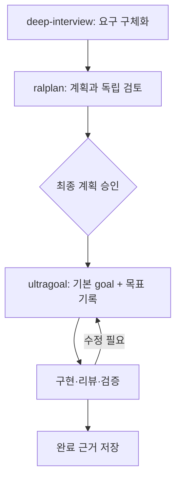

# oh-my-joy (OMJ)

[English](README.md) | 한국어

[](https://github.com/S-jooyoung/oh-my-joy/actions/workflows/ci.yml)
[](LICENSE)
[](package.json)

> **AI가 "다 했어요"라고 하면, OMJ는 증거를 내놓게 합니다.**

Claude Code와 Codex에서 하나의 실행 흐름을 사용합니다. 모든 작업은 `ultragoal`로 시작합니다. 작고 안전한 일은 플레이북으로 진행하고 확인하며, 위험하거나 큰 일만 계획 하나를 승인받고 증거를 기록하며 진행합니다. 모든 보고는 결론을 먼저, 그다음 당신이 할 일을 보여 줍니다. Figma → 코드는 계속 지원합니다.


<sub>실제 Claude Code 세션을 처음부터 끝까지 녹화했고, 기다리는 구간만 빠르게 돌렸습니다.</sub>

`증거 없으면 완료 아님` · `독립 비판` · `위험하거나 큰 일만 승인` · `쉬운 보고` · `재개 가능한 실행` · `Claude Code + Codex` · `Figma 내장` · `zero runtime deps`

[Quick Start](#quick-start) • [왜 만들었나](#왜-만들었나) • [OMJ 사용법](#omj-사용법) • [권장 워크플로](#권장-워크플로) • [커맨드](#커맨드) • [OMJ는 어떻게 발전하나](#omj는-어떻게-발전하나) • [트러블슈팅](#트러블슈팅)

---

## 작업별 실행과 팀 설정

Claude에서는 `/oh-my-joy:setup`, Codex에서는 `$oh-my-joy:setup`으로 최대 동시 워커 수(기본 2개)를 선택합니다. 모델은 호스트 기본값을 사용하며 예산은 묻지 않습니다.

개인 설정은 `~/.config/oh-my-joy/config.json`, 프로젝트 설정은 `.omj/config.json`에 저장합니다. 현재 작업에서 명시한 선택이 우선합니다. 리뷰어는 워커 한도에 포함하고 리드는 제외합니다. 열린 원장의 완료 조건은 유지하며, setup의 점검 모드는 아무것도 변경하지 않습니다.

호스트와 모드가 지원하면 선택형 질문을 사용합니다. 텍스트만 표시되는 환경에서는 짧은 번호로 답할 수 있게 합니다. 질문 도구 호출 성공만으로 선택 UI가 동작한다고 판단하지 않습니다. [설정](docs/EXECUTION-CONFIG.md)과 [실행 경로](docs/ADAPTIVE-EXECUTION.md)를 참고하세요. 질문 UI는 설치된 환경에서 실제 확인해야 하며, 계약 테스트만으로 검증 완료라 하지 않습니다.

## Quick Start

### Claude Code

```
# 1. 설치 (한 줄씩 입력)
/plugin marketplace add S-jooyoung/oh-my-joy
/plugin install oh-my-joy@omj

# 2. 의존성 점검 + 원하는 부가 기능 opt-in (첫 사용 전 권장)
/oh-my-joy:setup

# 3. 모든 작업은 ultragoal로 시작 — 작은 수정은 플레이북으로, 위험하거나 큰 일은 계획 승인에서 한 번 멈춤
/oh-my-joy:ultragoal "formatAmount('1,000')이 TypeError를 던져요 — 고치고 회귀 테스트도 추가해 주세요"
/oh-my-joy:ultragoal "공개 API rate-limit 미들웨어 — 키당 분당 100회"

#    …프론트엔드도 똑같습니다 — route를 붙이면 실제 브라우저에서 확인합니다
/oh-my-joy:ralplan "검색 입력 폼 — React Hook Form + Zod, 모바일 우선" /search

#    …디자인에서 시작한다면 — 같은 커맨드에 Figma 링크를 붙이면 됩니다
/oh-my-joy:ralplan https://figma.com/design/abc?node-id=1-2 /search

# 4. 증거가 모두 통과하면 내보내기
/oh-my-joy:ship "feat(api): rate limiter"
```

### Codex

```bash
# 1. 같은 공개 marketplace에서 설치
codex plugin marketplace add S-jooyoung/oh-my-joy
codex plugin add oh-my-joy@omj

# 2. 플러그인 skill을 읽도록 새 Codex thread를 시작한 뒤 setup 실행
$oh-my-joy:setup

# 3. 모든 작업은 ultragoal로 시작; 위험하거나 큰 일은 네이티브 Plan 승인에서 한 번 멈춤
$oh-my-joy:ultragoal "공개 API rate-limit 미들웨어 — 키당 분당 100회"

# 4. review와 verify가 통과한 뒤에만 ship
$oh-my-joy:ship "feat(api): rate limiter"
```

Codex는 같은 6개 워크플로 진입점, 내부 역할 3개, 공용 `frontend-fundamentals` 스킬을 제공합니다. Codex 전용 어댑터 9개는 Claude의 커맨드 메뉴와 모델 선택에서 숨기고, 공용 스킬은 두 호스트에서 계속 쓸 수 있습니다. 답변 스타일은 프로젝트 지침으로, 상태 표시는 Codex CLI 기본 상태 표시줄로 적용하며, 훅은 Codex 쓰기 이벤트를 처리합니다. Codex App에는 사용자 정의 HUD 영역이 없습니다. 전체 대조 결과는 [호스트별 기능 목록](docs/HOST-PARITY.md)에 있습니다.

업데이트하거나 이전 버전에서 넘어오셨나요? [업데이트와 업그레이드](#업데이트와-업그레이드)를 보세요.

---

## 왜 만들었나

AI 에이전트에게 작업을 맡겼을 때 가장 비싼 실패는 나쁜 코드가 아니라 **가짜 완료(fake done)** 입니다. 테스트를 한 번도 돌리지 않고 "다 했어요, 테스트 통과합니다"라고 하거나, 통과할 때까지 테스트를 건너뛰거나 느슨하게 고치거나, 원인은 그대로 둔 채 증상만 가리는 가드를 넣거나, 중간에 계획에서 벗어나거나, 코드를 쓴 그 컨텍스트가 스스로 리뷰합니다. 프론트엔드라면 디자인과 비슷해 보이는데 토큰이 raw hex로 인라인되어 있기도 합니다. **매번 다른 곳이 빠지기 때문에** 예방이 아니라 리뷰에서 뒤늦게 잡게 됩니다.

OMJ는 "완료"를 에이전트가 증명해야 하는 것으로 바꿉니다. 계획 진입 커맨드는 read-only입니다. 디자인이나 코드를 읽고, 플랜을 쓰고, 새 컨텍스트에서 비판을 받은 뒤 **멈춥니다**. 그 플랜이 곧 사용자가 승인할 네이티브 Plan이라서, Plan 모드의 쓰기 차단이 검토 게이트가 됩니다. 승인 뒤에는 플랜의 완료 절차가 알아서 돌고, 모든 단계가 주장 대신 증거를 남깁니다.

| 그냥 에이전트 세션 | OMJ와 함께 |
| --- | --- |
| 테스트 없이 "완료", 또는 통과할 때까지 약해진 테스트 | 명령·exit code·요약이 있어야 완료; 건너뛰거나 느슨해진 검사는 블로커 |
| 레포에 이미 있는 헬퍼를 다시 만들거나, 위험한 로직을 검사 없이 내보냄 | 플랜이 새 코드보다 재사용을 먼저 순위 매김(필요 없음 → 레포에 있음 → 표준 라이브러리/플랫폼 → 설치된 의존성); 다시 만든 헬퍼는 `over-build` finding; 분기·루프·파서·돈·보안·데이터 쓰기가 있는 로직은 깨지면 실패하는 검사 하나를 이름; 모든 보고는 주장마다 어떻게 확인했는지와 확인하지 않은 것을 밝힘 |
| 코드를 쓴 컨텍스트가 직접 리뷰 | 새 컨텍스트의 `critic`이 파일로 받은 diff를 읽음 |
| 디자인과 "비슷해 보임" | Figma 기준선과 실제 브라우저 캡처를 비교하고 goal 안의 수정 루프로 고침 |
| 합의한 것에서 슬금슬금 벗어남 | 승인한 플랜 하나; 범위와 수용 기준이 기록되고 고정됨 |
| 중단되면 처음부터 | `/oh-my-joy:ultragoal resume <slug>`가 같은 체크아웃에서 ledger를 이어감, Claude Code와 Codex를 오가도 마찬가지 |

끝난 goal이 남기는 기록의 모양(예시이며 줄인 것입니다. 실제 리포트에는 변경 파일·산출물·가정도 함께 나옵니다):

```
goal fix-format-amount (defect)
  verify  npm test -- format.test.mjs   exit 1   reproduces: TypeError in formatAmount('1,000')
  verify  npm test -- format.test.mjs   exit 0   14 passed · 0 skipped
  review  critic, fresh context         pass     no 🔴
final     npm test                      exit 0   212 passed · current workspace fingerprint
closed    .omj/goals/fix-format-amount/
```

---

## OMJ 사용법

**`/oh-my-joy:ultragoal`(Claude) 또는 `$oh-my-joy:ultragoal`(Codex)로 시작합니다.** 먼저 작업을 셉니다. 결과물이 하나인 작고 안전한 일은 계획·원장·질문 없이 플레이북으로 진행하고, 위험하거나 큰 일만 계획 하나를 승인받으려고 한 번 멈춥니다. 명시적인 `ralplan`과 `deep-interview`는 계획 단계를 유지하며, 새 PR을 여는 `ship`은 별도 요청으로 실행합니다.
_"거의 항상 Plan 모드"인 습관과 충돌하지 않는 Plan 네이티브 워크플로._

| 당신의 입력 | 일어나는 일 |
| --- | --- |
| 작고 안전함 — 결과물 하나, 파일 5개 이하 | `/oh-my-joy:ultragoal`이 플레이북을 골라 현재 세션에서 작업하고, 검사를 돌리고, 파일이 바뀌었으면 새 컨텍스트의 `critic` 리뷰를 한 번 받은 뒤(파일 하나에서 두 줄 이하 변경은 생략) 보고 |
| 위험함, 결과물 2개 이상, 또는 파일 6개 이상 | `/oh-my-joy:ultragoal`이 `/oh-my-joy:ralplan`에 넘기고, ralplan이 계획·비판한 뒤 한 번의 승인을 위해 멈춤 |
| 흐릿함 — 댈 파일도, 검사할 기준도 없음 | `/oh-my-joy:deep-interview` — 짧은 질문 라운드; 끝나면 요구사항을 `/oh-my-joy:ralplan`에 자동으로 넘김 |
| 계획을 먼저 읽고 싶음 | `/oh-my-joy:ralplan` — 코드나 디자인을 읽고, 계획을 세우고, 비판한 뒤 승인 화면에서 멈춤 |

### 플레이북

플레이북은 작은 작업 한 종류를 위한 짧은 절차입니다. 단계마다 확인 방법, 읽을 [원칙](#이름-붙은-원칙), 리뷰를 받는 조건, 보고에 꼭 들어갈 내용을 적어 둡니다.

| 플레이북 | 언제 쓰는가 |
| --- | --- |
| [버그 수정](docs/playbooks/bug-fix.md) | 무언가 잘못 동작할 때: 재현하고, 원인 자리를 찾아, 거기서 고치고, 같은 검사를 다시 돌림 |
| [기능](docs/playbooks/feature.md) | 작은 새 동작; 다른 플레이북에 맞지 않는 파일 수정 작업의 기본값이기도 함 |
| [리팩터링](docs/playbooks/refactor.md) | 구조는 바뀌고 동작은 그대로일 때 |
| [조사](docs/playbooks/investigation.md) | 바꾸지 않고 어떻게·왜를 묻는 질문; 아무것도 고치지 않을 때의 기본값이기도 함 |

플레이북 작업이 파일을 고쳤으면 `critic` 하나가 `.omj/review/`의 파일 세 개로 변경을 새 컨텍스트에서 읽습니다. 버그 수정·기능·리팩터링 플레이북은 파일 하나에서 두 줄 이하만 바뀐 경우에만 리뷰를 건너뜁니다. 리뷰가 세 번 실패하면 실행을 멈추고 양쪽 입장을 보고합니다. 일이 센 것보다 위험하거나 크다고 드러나면, 안전하게 끝낸 변경은 그대로 두고 나머지를 `ralplan`에 넘깁니다.

### 승인 화면이 나오는 경우

`ultragoal`은 짐작하지 않고 사실을 셉니다. 인증, 돈, 데이터 삭제나 마이그레이션, 동시성, 공개 계약, 외부 쓰기를 건드리는 일, 결과물이 둘 이상인 일, 파일을 6개 이상 바꾸는 일에만 승인 화면이 한 번 나옵니다. 나머지는 승인 화면 없이 진행합니다.

### 다섯 부분으로 된 보고

승인 화면, 완료 보고, verify 결과, ship 요약 등 OMJ의 모든 보고는 같은 다섯 부분을 당신의 언어로 보여 줍니다: 결론, 할 일, 바뀐 것, 대신 정한 것, 확인한 방법(확인이 얼마나 강한지 포함). 해시나 인자 목록은 증거에 남기고, 보고에는 증거 위치 한 줄만 둡니다. 규칙은 [docs/REPORTING.md](docs/REPORTING.md)에 있습니다.

```text
완료: 회원가입 폼이 도메인 없는 이메일 주소를 받지 않습니다.

할 일: 없습니다. 준비되면 머지하시면 됩니다.

바뀐 것:
- "ana@" 입력: 서버가 알 수 없는 오류로 거절함 → 폼에서 바로 "이메일 주소를 끝까지 입력해 주세요"라고 알려 줌

대신 정한 것:
- 서버가 저장할 때 이미 검사하므로 검사는 폼에만 넣었습니다. 되돌리려면 SignupForm.tsx의 validateEmail을 지우면 됩니다.

확인한 방법:
- 실제 앱에서 실행: "ana@"와 "ana@example.com"을 제출해 봤습니다(측정).
- 테스트 실행: 고치기 전에 실패하던 새 테스트 "도메인 없는 주소를 거부한다"를 포함해 `SignupForm.test.tsx`가 통과합니다(측정).

증거: .omj/goals/signup-email/ 아래 실행 기록
```

"더 쉽게 말해 줘"라고 하면 같은 보고를 사실과 숫자는 하나도 빼지 않고 더 쉬운 말로 다시 해 줍니다. 실행 중에 "지금 어디까지 왔어?"라고 물으면 따라잡기 보고가 나옵니다: 한 문장에서 세 문장의 요약, 항목마다 완료·실패·진행 중·막힘, 그리고 당신이 정해야 할 것.

| 표면 | 무엇인가 |
| --- | --- |
| 런타임 문법 | Claude Code: `/oh-my-joy:<name>` · Codex: `$oh-my-joy:<name>` |
| 계획 작업에서 입력 | `/oh-my-joy:deep-interview`(흐릿할 때만) → `/oh-my-joy:ralplan` → 승인 → `/oh-my-joy:ultragoal` |
| 계획된 ultragoal 내부 절차 | goal마다: 헬퍼가 검사를 돌리고 새 컨텍스트의 `critic`이 파일로 받은 diff를 읽음; route가 있으면 `/oh-my-joy:verify` 브라우저 모드 → goal 안의 수정 루프; Agent Teams가 켜져 있으면 분리된 goal 2개 이상은 implementer 팀원이 병렬로 — 승인한 플랜에 그렇게 적혀 있으므로 |
| 가끔 쓰는 도구 | `/oh-my-joy:setup`(의존성·스캐폴딩) |
| 내부, 절대 치지 않음 | `critic`(새 컨텍스트에서 한 번 읽음), `implementer`, `design-qa` |

아래 계획 작업 상황은 큰 작업이나 계획을 먼저 보고 싶은 작업에 해당합니다. 여덟 가지 상황이 대부분의 하루를 덮습니다. 각각은 실제로 치는 순서 그대로이고, 모든 스펙은 당신이 보기 전에 스스로를 비판하며, 승인과 ship 사이의 일은 승인한 플랜에 적혀 있으므로 알아서 진행됩니다.

**1. Figma 화면 하나**

```
/oh-my-joy:ralplan https://figma.com/design/abc?node-id=1-2 /checkout
  → 스펙이 ## Critique로 끝남 → 플랜 승인 → 구현 → 헬퍼 검사 + critic 리뷰 → /oh-my-joy:verify /checkout → fix 루프 → 보고 (자동)
/oh-my-joy:ship "feat(checkout): summary panel"
```

**2. 큰 Figma 프레임 (섹션 여러 개)**

```
/oh-my-joy:ralplan https://figma.com/design/abc?node-id=1-2 /checkout
  → spec이 프레임을 섹션별로 읽고 Dispatch 표와 ## Critique로 끝냄; 최종 계획에 권장 agent-team 레인을 기록
  → 플랜 승인
  → ultragoal이 섹션을 공유 task list에 미러링하고 섹션마다 implementer 팀원을 생성 (CLAUDE_CODE_EXPERIMENTAL_AGENT_TEAMS=1 필요; 분리된 goal 2개면 충분; 플래그가 없으면 3개 이상은 서브에이전트, 그 외 inline)
  → 팀원마다 evidence 줄로 task를 닫음 → 리드가 섹션별 검사와 critic 리뷰를 기록하고 결과를 기록한 팀원·리뷰어를 바로 종료 → /oh-my-joy:verify /checkout이 barrier → 보고 (자동)
/oh-my-joy:ship "feat(checkout): all sections"
```

**3. 말로 설명한 프론트엔드 기능**

```
/oh-my-joy:ralplan "검색 입력 폼 — React Hook Form + Zod, 모바일 우선" /search
  → 스펙이 ## Critique로 끝남 → 승인 → 구현 → 헬퍼 검사 + critic 리뷰 → verify /search → fix 루프 → 보고 (자동)
  → 새 페이지나 섹션이면 스펙에 Design direction이 붙고, Figma 기준이 없으면 verify가 데스크톱·태블릿·모바일에서 렌더된 디자인을 감사
/oh-my-joy:ship "feat: search form"
```

**4. 백엔드·스크립트·인프라 — UI가 아닌 모든 작업**

```
/oh-my-joy:ralplan "공개 API rate-limit 미들웨어 — 키당 분당 100회"
  → 스펙에 수용 기준과 찾아낸 검증 명령(verifyCommands 또는 package.json scripts)이 적히고, 당신의 파일에 대해 스스로를 비판함
  → 승인 → 구현 → 헬퍼 검사 + critic 리뷰 → /oh-my-joy:verify (증거 모드: 명령을 돌리고 exit code를 기록) → 보고 (자동)
/oh-my-joy:ship "feat(api): rate limiter"
```

**5. 뭘 만들지 아직 흐릿할 때**

```
/oh-my-joy:deep-interview "알림 시스템 개편 — 어디서 시작할지 모르겠음"
  → 모호도 점수가 통과할 때까지 짧은 질문 라운드(서로 무관한 질문은 한 번에 최대 세 개) → 종료 브리지가 요구사항을 /oh-my-joy:ralplan에 넘김(추가 명령 입력 없이 자동 연결)
  → ## Critique가 붙은 스펙이 곧 플랜 → 승인 → 같은 완료 절차
/oh-my-joy:ship
```

**6. 시각 결함**

```
/oh-my-joy:ultragoal "/pricing 배너 z-index가 낮아요"     버그 수정 플레이북 → 확인 → 보고
```

**7. 계획부터 보고 싶은 버그**

```
/oh-my-joy:ralplan "formatAmount('1,000')이 TypeError: Cannot read properties of undefined (reading 'toFixed')를 던짐"
  → 플랜이 실패 지점에서 거꾸로 잘못된 값이 만들어지는 곳까지 추적하고 재현 확인을 정함
  → 승인 → 재현 확인이 실패하는 것을 기록 → 원인에서 수정 → 재현 확인이 통과하는 것을 기록 → review → 보고 (자동)
/oh-my-joy:ship "fix(format): parse thousands separators"
```

모든 커맨드는 단독으로도 씁니다 — 재확인(`/oh-my-joy:verify /checkout`), 디자인 감사(`/oh-my-joy:verify /pricing --design`). 단독 diff 리뷰는 호스트의 내장 리뷰를 쓰세요.

---

## 권장 워크플로

처음이라면 `/oh-my-joy:setup`을 한 번 실행하세요 — 선택 의존성을 점검하고, Agent Teams 플래그와 OMJ 답변 스타일을 제안하고, `.omj/fe-context.md`를 스캐폴딩합니다.

1. **진입** — 구체적인 것(Figma, 프론트엔드 텍스트, 범용 텍스트)은 `/oh-my-joy:ralplan <figma-url | task> [route]`; 목표 자체가 흐릿하면 `/oh-my-joy:deep-interview`. 둘 다 스펙을 쓰고, 실제 코드에 대해 비판하고(결정 기록, 시뮬레이션, 그리고 계획이 파일 2개를 넘거나 모양 변경·위험이 있으면 `critic` 한 번), 실행 레인과 완료 절차를 기록하고, 다섯 부분으로 된 승인 카드에서 멈춥니다.
2. **플랜 승인**(ExitPlanMode) — 구현은 여기서만 시작되고, 스펙이 기록한 레인에서 돕니다. 계획에 권장 실행 레인을 기록하며 별도 레인 승인 질문은 하지 않습니다.
3. **플랜이 실행됨** — 레인에서 구현하고(질문 없이; 블로커는 분류해서 보고), 독립 `critic` 리뷰(diff를 루브릭과 스펙의 수용 기준에 대조), `/oh-my-joy:verify`(라우트를 실제 브라우저에서, 또는 검증 명령을 exit code와 함께), 프론트엔드 결함이면 수정 루프, 그리고 증거가 붙은 보고.
4. **Ship** — `/oh-my-joy:ship "<title>"`이 먼저 이 세션에서 일을 마친 에이전트를 닫고(아직 일하는 teammate가 있으면 검증 전에 멈춤), 검증 명령을 다시 돌리고, 프로젝트 컨벤션으로 커밋하고, push하고, 증거를 붙인 PR을 엽니다. `develop`으로 머지하는 팀은 `--base develop`을 붙이거나 질문 하나에 답하면 됩니다. 이 단계는 절대 자동으로 돌지 않습니다.

**척추 한눈에 보기.** 각 단계는 한 가지 일을 하는 게이트입니다.

| 단계 | 게이트 | 확인하는 것 |
| --- | --- | --- |
| `/oh-my-joy:deep-interview` | 명확성 — 목표가 흐릿할 때만; 구체적인 입력은 다음 행부터 | 모호도가 임계값 이하, 점수가 그 아래로 내려갈 수 없는 하한 포함; 끝나면 요구사항을 `ralplan`에 넘김(추가 명령 입력 없이 자동 연결) |
| `/oh-my-joy:ralplan` | 실현 가능성 | 비판: 자기 점검(결정 기록, 실제 파일에 대한 시뮬레이션), 그리고 계획이 파일 2개를 넘거나 모양 변경·위험이 있으면 `critic` 한 번; 남은 지적은 승인 카드에 보임 |
| 승인 (ExitPlanMode) | 동의 | 스펙과 비판을 읽습니다; 아직 아무것도 돌지 않음 |
| 구현 | 증거, 질문 없음 | 블로커는 `resolvable` 또는 `human-only`로 분류; 가정은 기록; goal 리뷰에 🔴가 있으면 다시 리뷰하고, 🟡 수정은 goal 완료 뒤 반영해 최종 리뷰가 확인 |
| `/oh-my-joy:verify` | 종류별 증거 | test report · command replay · browser capture, 각각 exit code와 함께 |
| `/oh-my-joy:ship` | 당신의 것 | 검증 명령, 커밋, push, PR |



기록을 남기는 실행에는 Node.js 20 이상과 Git 작업 트리가 필요합니다. 새 폴더라면 계획에 로컬 Git 초기화를 명시하고 승인받은 뒤 기록을 생성합니다.

한 번 진입하고, 위험하거나 큰 일만 한 번 승인합니다. 계획이 현재 세션 실행 또는 네이티브 병렬 실행을 선택하고, 노출된 기본 goal이 작업 지속을 돕습니다. 사용자가 goal 명령을 따로 실행할 필요는 없습니다. 관계없는 goal을 지우거나 호스트 권한 확인을 우회하지 않습니다. 호출 가능한 goal 기능이 없어도 현재 세션의 반복 실행과 파일 기반 재개는 동작하지만, 백그라운드 지속 실행을 보장하지는 않습니다.

`/oh-my-joy:ultragoal resume <slug>`(또는 `--resume <slug>`)로 같은 체크아웃의 승인된 작업을 이어갑니다. Claude Code와 Codex 사이에서도 같은 기록을 사용합니다. `/oh-my-joy:ultragoal status <slug>`는 상태를 조회합니다. 승인한 계획과 완료 기준은 유지하며, 범위가 크게 달라지면 다시 계획합니다. 다른 체크아웃에서는 새 실행을 시작하며, 상태 복사만으로 승인이 이전되지는 않습니다.

push, 새 PR 생성, 머지는 이 자동 흐름에 포함하지 않으며, 새 PR은 `/oh-my-joy:ship`으로 진행합니다.

호스트별 연결·폴백·완료 기준의 정본은 [docs/EXECUTION-HANDOFF.md](docs/EXECUTION-HANDOFF.md)입니다.

---

## Figma 링크는 무엇이 되나

섹션이나 프레임 링크를 붙이면 `ralplan`이 데이터로 읽고, 프레임마다:

1. **픽셀이 아니라 데이터로 읽습니다** — 공식 Dev Mode MCP로 레이아웃 구조, 그 뒤의 디자인 변수, 그리고 나중에 `verify`가 비교할 베이스라인 스크린샷을 가져옵니다.
2. **큰 프레임은 섹션별로 걷습니다** — 최상위 섹션이 3개 이상인 프레임은 한 번에 읽지 않고(한 번에 읽으면 뭉개져 돌아옵니다) 메타데이터 먼저, 그다음 섹션마다 design-context 호출 하나로 읽습니다. 스펙에는 섹션별 분해와, 각 섹션이 어느 파일을 소유할지 적은 Dispatch 표가 붙습니다. 8개를 넘으면 링크 분할을 제안합니다.
3. **색·타이포·radius·shadow 전부를 시맨틱 토큰에 매핑합니다** — 토큰 시스템을 감지하고(fe-context → tokens.json → Tailwind config → CSS 변수) tokens.json이 없는 프로젝트에서도 raw hex는 선택지가 아닙니다.
4. **fidelity 규칙을 켜둡니다** — 원문 텍스트 유지, Figma에 없는 variant 창작 금지, 고정 px 대신 `w-full` + 부모 padding.
5. **보기 전에 스펙을 채점하고, 그다음 비판합니다** — uSpec 6 섹션(Uber의 디자인 스펙 분류: Anatomy / Structure / Color·Tokens / Props·Variants / A11y / Motion)을 각각 FF 기준(Toss frontend-fundamentals: 가독성·예측 가능성·응집도·결합도) + 접근성으로 평가한 뒤, 대표 작업 2~3개를 당신의 파일에 대해 시뮬레이션하고 `## Critique` 섹션에 결정 기록과 판정을 남깁니다.

그래서 "이 프레임 만들어줘" 프롬프트처럼 결과가 표류하지 않습니다. 모델이 스크린샷을 눈대중하는 게 아니라, 구조화된 디자인 데이터로 고정된 골격을, 당신의 토큰 어휘로, 알맞은 입도에서 채우고, 기록한 베이스라인이 `verify`가 빌드와 비교할 대상이 됩니다.

---

## 한 세션 처음부터 끝까지

작업: 검색 입력 폼 — React Hook Form + Zod, 모바일 우선, `/search`에 마운트.

디자인에서 시작한다면 같은 커맨드에 링크를 붙이면 됩니다 — `/oh-my-joy:ralplan https://figma.com/design/abc?node-id=1-2 /search` — 위에서 설명한 Figma 트랙이 돌고, 스펙 이후는 동일합니다. 백엔드 작업이라면 같은 커맨드이고, 스펙 골격이 목표 / 제약 / 수용 기준 / 검증 명령으로 바뀝니다.

    /oh-my-joy:ralplan "검색 입력 폼 — React Hook Form + Zod, 모바일 우선" /search

`ralplan`은 `/search`를 검증 라우트로 떼어내고, Figma URL이 없으니 프론트엔드 작업으로 인식해 기존 폼 컴포넌트·훅·토큰 설정을 읽고, 구현 스펙을 씁니다 — FF 기준으로 채점된 uSpec 6 섹션, 대상 파일과 재사용 후보까지. 계획은 목표 단위, 수용 기준, 허용된 전달 범위, ultragoal 자동 연결 절차로 끝납니다. 이처럼 작은 작업은 승인 후 inline으로 실행됩니다.

**여기서 당신이 결정합니다.** 스펙은 승인 화면의 플랜입니다 — 고치거나, 거절하거나, 승인(ExitPlanMode)하세요. 아직 아무것도 쓰이지 않았습니다.

승인하면 세션이 ultragoal을 자동 실행해 계획을 inline으로 구현하고 승인한 절차를 돌립니다:

    헬퍼 verify                 플랜의 검증 명령을 돌리고 exit code를 현재 fingerprint에 기록
    critic (새 컨텍스트)        파일로 받은 diff를 스펙의 수용 기준으로 읽음 — 보고만
    /oh-my-joy:verify /search   실제 브라우저에서 /search를 열고 스펙과 Figma 베이스라인에 대조

verify가 결함을 보고했다고 합시다 — 제출 버튼 라벨이 360px에서 잘립니다. goal 안에서 고치고, 같은 뷰포트를 재캡처하고, 결함이 사라졌음을 확인하면 세션이 증거와 함께 보고합니다. 그리고 당신 몫인 한 줄:

    /oh-my-joy:ship "feat: search form"

`ship`은 검증 명령을 다시 돌리고, 프로젝트 컨벤션으로 커밋하고, push하고, 확인마다 한 줄씩 적은 PR을 엽니다.

---

## 커맨드

| 커맨드 | 티어 | 하는 일 | 언제 | 예시 |
| --- | --- | --- | --- | --- |
| **`/oh-my-joy:ultragoal`** | 작업 또는 승인된 계획 | 작고 안전한 작업은 플레이북으로 확인과 함께, 파일이 바뀌면 새 리뷰 한 번과 함께 진행하고, 위험하거나 큰 작업은 계획으로 연결. 승인된 작업은 계획 실행, 목표 근거 기록, 리뷰·검증·재개; `resume <slug>`, `status <slug>` 지원. 새 검사의 실패 기록은 플랜이 지정한 위반 때문에 실패했을 때만 인정합니다. 목표 리뷰를 통과하면 바로 다음 목표로 넘어가고, 같은 코드에서 이미 통과한 최종 검사는 다시 돌리지 않고 `reuse:true`로 기록할 수 있으며, `verify`로 돌린 검사는 마지막 출력 줄을 함께 돌려줌. 리뷰는 diff를 파일로 받은 `critic` 읽기이며 goal의 검사와 같은 턴에 띄움; 유료 검사는 goal 안에서 한 번만 돌고 final proof에 포함되지 않음; Agent Teams가 켜져 있으면 분리된 goal 2개 이상은 공유 task list 위의 implementer 팀원이 병렬로 실행. 승인과 보고 사이에는 묻지 않음: 플랜이 비워 둔 선택은 Recommended로 둘 선택을 취해 가정으로 기록; goal이 끝날 때 사용자 언어로 진행 줄 하나를 찍고, 보고는 다섯 부분으로 하며 남긴 후속은 resume 경로와 함께 할 일에 적음. `status <slug>`는 짧은 따라잡기 보고를 줌. | 로컬 작업, 승인된 작업 또는 중단된 실행 | `/oh-my-joy:ultragoal resume checkout` |
| **`/oh-my-joy:ralplan`** | 당신 | 입력(큰 프레임은 섹션 워크로 읽는 Figma 링크, 프론트엔드 텍스트, 범용 텍스트)을 읽고, 구현 스펙(Plan)을 쓰고, 실제 코드에 대해 비판하고(`## Critique`: 결정 기록, 시뮬레이션; 계획이 파일 2개를 넘거나 모양 변경·위험이 있으면 새 컨텍스트의 `critic` 한 번), 다섯 부분 승인 카드로 보여 주고, 실행 레인과 완료 절차를 기록하고 멈춤(read-only). 세션에 있는 인터뷰 요구사항도 입력으로 받음. 생략된 verify 라우트는 추론; 검증 가능한 목표가 없는 텍스트는 인터뷰로 안내. 위험한 계획은 배포된 변경이 실패할 수 있는 방식도 짚고, 새 검사는 통과 전에 실패하는 모습을 보여야 하며, 조기 종료한 인터뷰의 `Residual gaps`는 승인 화면의 가정이 됨. 대상 파일에는 재사용 사다리(필요 없음 → 레포에 있음 → 표준 라이브러리/플랫폼 → 설치된 의존성 → 최소 신규 코드; 새 의존성은 결정 행)가 붙고, 위험한 새 로직은 깨지면 실패하는 검사 하나를 받으며, 카드의 할 일에는 세션이 직접 못 하는 것만 남기고, 이전 실행의 닫히지 않은 ledger는 `resume <slug>`와 함께 한 번 알림 | 구체적인 모든 작업의 시작점 | `/oh-my-joy:ralplan https://figma.com/design/abc?node-id=1-2 /settings/profile` |
| **`/oh-my-joy:deep-interview`** | 당신 | 모호한 아이디어를 짧은 질문 라운드(서로 무관한 질문은 한 번에 최대 세 개)의 소크라테스식 인터뷰로 스펙(네이티브 Plan)으로 만듦. 가중 모호도 점수(`--threshold N`%, 기본 20) — 토폴로지 고정, 최약 차원 타깃, 온톨로지 추적, 모호도 하한, 재진술/클로저 이중 게이트(read-only); 종료 브리지로 끝남 — 요구사항을 `ralplan`에 자동 전달하며 해결되지 않은 조사 전제는 명시합니다. 답에 따라 요구사항이 달라질 때만 묻고 그렇지 않으면 가정으로 기록하며, 조기 종료나 라운드 상한에서는 남은 공백을 `Residual gaps`로 `ralplan`에 넘깁니다. 이미 구체적인 입력은 즉시 종료, Figma 링크는 `ralplan`으로 | 목표 자체가 아직 흐릿할 때 | `/oh-my-joy:deep-interview "사내 지식 베이스 — 아직 흐릿함"` |
| **`/oh-my-joy:ship`** | 당신 | 이 세션에서 일을 마친 teammate 정리(`ListAgents` → `TaskStop`; 다른 세션은 건드리지 않고, 아직 일하는 teammate가 있으면 멈춤), 검증 명령 실행(전부 exit 0이어야 하고, 테스트가 0개 실행된 스위트는 실패로 봄), 브랜치에서 프로젝트 컨벤션·언어로 커밋, push, 확인마다 한 줄과 증거 위치를 적은 40줄 이하의 PR 생성(레포에 PR 템플릿이 있으면 그 형식, 없으면 보고 다섯 부분). `--base <ref>`로 PR base 지정, 없으면 이미 명확하게 정해진 base를 재사용하고 대상이 불명확할 때만 한 번 물음. 공유 브랜치(`main`, `develop` …)나 detached HEAD에서는 직접 커밋하지 않음: 변경이 있으면 먼저 갈라 나오고, 깨끗한 detached HEAD에 base보다 앞선 커밋이 있으면 새 브랜치로 그 커밋을 ship하고, 깨끗한 `develop`에서는 승격 PR을 엶. git/gh/typecheck만 사전 승인 — 테스트 러너는 일부러 권한 프롬프트를 거침 | 마지막 단계, 항상 당신이 침 | `/oh-my-joy:ship "feat(checkout): summary panel"` |
| **`/oh-my-joy:verify`** | 플랜 | 작업을 증명. 라우트가 있으면 실제 브라우저(playwright-cli, MCP 폴백)로 열어 Figma 베이스라인(`.omj/baselines/`)에 대조하고 요청한 라우트에 실제로 도달했는지 항상 확인. 디자인 기준이 없거나 `--design`이면 데스크톱·태블릿·모바일에서 렌더된 디자인을 시각 루브릭(위계, 상태, 대비, 넘침, 템플릿 tell)으로 감사하고 보고만 함. 라우트가 없으면 프로젝트의 검증 명령을 돌려 `명령 · exit code · 요약`을 증거 종류·확인 강도와 함께 기록하며, 테스트가 0개 실행된 명령은 exit 0이어도 실패이고 실행하지 못한 명령은 `not confirmed`. 축소된 전체 화면 캡처는 증거 한계로 보고. `--base <url>`은 dev 서버, `--design`은 감사 강제 | review 뒤 플랜이 실행; 팀원 완료 뒤 barrier | `/oh-my-joy:verify /settings/profile` · `/oh-my-joy:verify /pricing --design` · `/oh-my-joy:verify` |
| **`/oh-my-joy:setup`** | 가끔 | 의존성 진단 + 빠진 항목의 다중 선택 설치 + 스캐폴딩: `.omj/fe-context.md`(기존 규칙 문서를 `contextDocs:`로 채택, `verifyCommands:`를 package.json에서 주석으로 스캐폴드), opt-in 토큰 가드 훅, opt-in 팀 증거 게이트 훅과 헬퍼 bookkeeping allowlist(Claude 전용), 호스트별 상태 표시, 사용 가능한 네이티브 에이전트, OMJ 답변 스타일; 끝에 GitHub star 제안(막지 않음) | 첫 사용 전 — 설정 흔적이 없으면 `ralplan`이 한 번 제안 | `/oh-my-joy:setup` · `--check` (보고만) |

> **읽기와 실행.** `deep-interview`에는 쓰기 도구나 셸 사전 승인이 없습니다. `ralplan`은 소스를 바꾸지 않고 코드·디자인 정보를 읽습니다. `ultragoal`은 계획 작업을 승인 뒤에 실행하고, 작고 안전한 일은 승인 없이 플레이북으로 진행하며, 검증 명령의 실제 exit code를 기록합니다. 도구 권한은 호스트 설정을 따릅니다. 동작의 정본은 `commands/<name>.md`입니다.

>
> **자동 트리거.** 커맨드 description은 가장 흔한 실제 패턴에 맞춰 쓰여 있어 슬래시 커맨드를 치지 않아도 라우팅됩니다: Figma Dev Mode 링크를 붙이며 "이 디자인 구현해줘"는 `/oh-my-joy:ralplan`으로.

### 번들 에이전트, 답변 스타일, opt-in 부가 기능

- **`critic`** (에이전트) — `ralplan`이 파일 2개를 넘거나 모양 변경·위험이 있는 계획에 한 번, `ultragoal`이 goal마다와 최종 리뷰, 플레이북 변경에 띄우는 read-only 리뷰어. 그 자료를 쓰지 않은 새 컨텍스트에서 읽고 쉬운 말 판정과 finding만 돌려주며 편집하지 않음; 정확히 `Read`, `Grep`, `Glob`만 선언(테스트로 고정). 코드를 실행하지 않고는 얻을 수 없는 증거는 추측하지 않고 `Declined to judge` 줄로 남김. 직접 치지 않음.
- **`implementer`** (에이전트) — **승인된 OMJ 스펙**을 5단계 루프(Clarify → Context → Plan → Generate → Evaluate)로 프론트엔드 모드(uSpec, Figma, 라우트) 또는 범용 모드로 구현하는 inline 레인 실행자이자, 모든 Dispatch 행의 팀원 타입: 행마다 인스턴스 하나, 그 행의 파일만 편집, 실행 중 질문 없음, 플랜이 기록한 단만 지음(플랜이 이름하지 않은 옵션·래퍼·추상화 없음), 블로커 분류, 증거·확인하지 않은 것·임시 조치(이유, 한계, 없앨 조건)와 함께 완료 보고; 배정된 일이 없으면 일을 지어내지 않고 기다림. inline 리드도 같은 계약을 따름. 스펙 없는 입력은 거절(플랜 게이트 우회 없음).
- **`design-qa`** (에이전트) — **검사만** 하는 기계적 게이트: 타입체크, 린트, 하드코딩 토큰, Figma fidelity, a11y 기본, 그리고 fe-context에 선언된 경우에만 Story/i18n 검사. 쓰기 도구 미선언(테스트로 고정).
- **교차 호스트 리뷰** (opt-in) — `.omj/fe-context.md`에 `crossReview: preferred`를 선언하면 `ultragoal`의 goal 리뷰와 최종 리뷰가 반대 호스트에서 읽기 전용으로 실행됩니다. Claude가 쓴 것은 Codex가, Codex가 쓴 것은 Claude가 리뷰합니다. 리뷰어가 출력 파일을 직접 남기고 원장은 그 해시를 기록합니다. 🔴는 평소처럼 수정, 재검증, 재리뷰 루프를 거칩니다. 플랜과 diff가 두 번째 제공자에게 전송되고 리뷰마다 호출이 한 번 더 들기 때문에 setup이 켜기 전에 묻습니다. 한도 소진처럼 반대 호스트를 실행할 수 없을 때, 세션 안 리뷰어로 계속하면서 그 이유를 원장과 보고서에 남깁니다. 작업하던 호스트의 한도가 끝나면 반대 호스트가 같은 원장을 이어받습니다. 리드 세션에서 한 번 승인한 플랜을 워커 세션이 실행하는 "넘겨받은 플랜"도 같은 문서에서 다룹니다: [`docs/CROSS-HOST.md`](docs/CROSS-HOST.md).
- **OMJ 답변 스타일** (`output-styles/oh-my-joy.md`, opt-in) — 자연스러운 모국어 답변, 초보 개발자도 이해할 설명, 바뀌는 것부터 말하는 짧고 쉬운 문장, 측정·추론·추측 표시, 보고 다섯 부분, 커맨드를 치지 않아도 적용되는 가장 작은 완전한 변경(새 코드보다 재사용, 위험한 로직엔 검사 하나), 승인된 다음 단계의 자동 진행. 한국어 규칙은 [fluent-korean](https://github.com/snflkd/fluent-korean)에서 재작성했으며 [`NOTICE.md`](NOTICE.md)에 출처를 기록했습니다. Claude Code는 setup이나 `/config`의 **Output style**에서 선택합니다. Codex setup은 같은 본문을 `.omj/answer-style.md`에 복사하고 실제 적용되는 프로젝트 `AGENTS.md` 또는 `AGENTS.override.md`에 연결하며 기존 지침을 보존합니다. 선택 뒤 새 세션을 시작하세요.
- **토큰 가드 훅** — `check-design-tokens.mjs`는 하드코딩 색상을, `check-story-exists.mjs`는 Story 누락을 경고합니다. setup이 선택한 검사만 `.claude/hooks/` 또는 `.codex/hooks/`에 복사하며, Codex에는 명령 입력 어댑터와 `.codex/hooks.json`도 등록합니다. 프로젝트 선언과 호스트 자체 신뢰 승인이 필요합니다. 경고만 하고 오류 시 작업을 막지 않으며 플러그인 전체에서 자동 실행하지 않습니다. Codex 어댑터는 알 수 없는 셸 편집까지 추측하지 않습니다.
- **OMJ HUD statusline** — Claude Code는 선택 시 `hud/`를 `~/.claude/omj-hud/`로 복사해 `statusLine`을 등록합니다. 두 호스트 모두 상태 표시줄 선택 시 전역 적용하며, 사용자 지정 설정 교체도 선택한 경우에만 수행합니다. Codex CLI는 기본 `tui.status_line`으로 모델·추론 강도·브랜치·남은 컨텍스트·5시간 및 주간 한도를 표시합니다. Codex App에는 사용자 정의 HUD 영역이 없습니다. 사용량 엔드포인트가 403을 돌려주면 Claude HUD가 약 90초마다 1토큰 모델 요청을 보내 사용량을 씁니다. `~/.claude/settings.json`에 `"omcHud": {"elements": {"rateLimits": false}}`를 넣으면 꺼집니다. 출처는 [`NOTICE.md`](NOTICE.md), 호스트별 설정은 [`hud/README.md`](hud/README.md)를 참고하세요.

---

## 선택 연동 (graceful degradation)

없어도 죽지 않습니다 — OMJ는 **건너뛰고 안내**합니다.

| 의존성 | 사용처 | 없을 때 |
| --- | --- | --- |
| 공식 Figma Dev Mode MCP | `/oh-my-joy:ralplan`(디자인 읽기) | "Figma 미연결 — 수동 스펙으로 진행" 후 계속 |
| `playwright-cli` **또는** playwright MCP | `/oh-my-joy:verify` 브라우저 모드(cli 우선, MCP 폴백) | 둘 다 없으면: "캡처 백엔드 없음 — verify 건너뜀" 후 종료; 증거 모드는 계속 동작 |
| Context7 | `/oh-my-joy:ralplan`(최신 Next.js 문서) | 그 단계만 건너뜀 |
| `CLAUDE_CODE_EXPERIMENTAL_AGENT_TEAMS=1` | agent-team 레인(네이티브 Agent Teams) | 레인이 서브에이전트, 그다음 inline으로 강등 |

> 디자인을 읽으려면 **Figma 데스크톱 앱이 실행 중이고 대상 파일이 활성 탭**이어야 합니다. MCP 도구 이름은 환경마다 다릅니다 — `/mcp`로 확인하세요.

---

## OMJ가 여러분 레포에 쓰는 것들

- `.omj/goals/<slug>/` — ultragoal이 기록하는 승인된 계획·목표 상태·추가 전용 이벤트 기록·검증 결과. 명령 출력을 포함할 수 있으므로 로컬에 보관합니다.
- `.omj/fe-context.md` — 프로젝트 선언(수용 축, 토큰 경로, verify 설정, `verifyCommands`). **커밋하는 파일입니다.**
- `.omj/review/` — 플레이북이 리뷰어에게 넘기는 요청·diff·새 파일 목록(`last-request.md`, `last.diff`, `last.files`). 다음 실행이 덮어씁니다. gitignore하세요.
- `.omj/baselines/` — 캡처 베이스라인. 이 경로와 `.omj/review/`, `.omj/goals/`를 gitignore하세요. `.omj/` 통째로 무시하면 커밋해야 할 fe-context까지 사라집니다.
- `.claude/hooks/` 또는 `.codex/hooks/`의 선택한 훅 복사본과 호스트별 등록 — setup에서 선택한 경우에만.
- `.claude/hooks/task-completed-evidence.mjs`와 `hooks.TaskCompleted` 등록, fe-context의 `teamEvidenceGate: true` — setup에서 선택했을 때만; ultragoal 팀원 task는 통과한 `evidence:` 줄이 붙기 전까지 닫히지 않습니다.
- `.claude/settings.local.json`의 `goal-state.mjs` bookkeeping verb `permissions.allow` 규칙(설치본 경로가 사용자 홈 아래라 공유 파일이 아닌 사용자별 파일), 그리고 `~/.claude/.omj-setup.json`에 기록되는 Agent Teams 플래그 — 각각 opt-in일 때만.
- `~/.claude/omj-hud/`(그리고 `statusLine` 항목), Agent Teams `env` 플래그, `~/.claude/settings.json`의 `outputStyle` 선택 — 사용자 전역이며 각각 `/oh-my-joy:setup`에서 opt-in한 경우에만.
- Codex 선택 항목: `.omj/answer-style.md`와 프로젝트 지침 연결, `$CODEX_HOME/config.toml`(기본 `~/.codex/config.toml`)의 전역 CLI 상태 표시줄. 프로젝트 재정의는 보존합니다. 전역 상태 설정은 Git 저장소 밖에서도 가능하며, 프로젝트 setup만 `.omj/setup.json`에 기록합니다.
- 요청 시: 프로젝트의 `docs/DESIGN.md`(setup 스캐폴드).

호스트별 설치 위치와 절차는 [`commands/setup.md`](commands/setup.md)와 [`docs/CODEX-SETUP.md`](docs/CODEX-SETUP.md)에 있습니다.

---

## 이 레포가 보여주는 것

아래 각 주장은 이 레포에서 확인할 수 있습니다 — 산출물의 이름과, 기각한 대안까지.

- **최소 권한은 관례가 아니라 매니페스트에 선언됩니다.** `/oh-my-joy:ralplan`은 읽기 전용 저장소 검사와 Figma/Context7 도구로 배포되고([`commands/ralplan.md`](commands/ralplan.md)), `/oh-my-joy:ship`은 git·gh·typecheck만 사전 승인하고 테스트 러너는 절대 승인하지 않습니다([`commands/ship.md`](commands/ship.md)). 호출하지 않는 곳에는 쓰기 도구가 사전 승인되지 않으므로 조용한 쓰기가 일어날 수 없습니다. 기각: "도구는 주되 쓰지 말라고 지시" — 산문은 강제 계층이 아닙니다.
- **사실 하나에 소스 하나, 그리고 문서 사실은 CI가 검사합니다.** 실행 레인 임계값과 완료 절차는 [`docs/EXECUTION-HANDOFF.md`](docs/EXECUTION-HANDOFF.md)에만 있습니다. 의존성 없는 스위트가 두 README의 커맨드 집합과 설치 문자열 일치, 영어 문서의 한국어 누출 없음, 상대 링크 유효성, 폐기된 커맨드·에이전트 이름의 마이그레이션 표 잔류를 검사합니다([`tests/docs-consistency.test.mjs`](tests/docs-consistency.test.mjs)).
- **프롬프트 본문은 프롬프트 가이드를 따르고, 테스트가 그렇게 말합니다.** 모든 커맨드·에이전트·스킬·스타일 본문은 무엇을 왜 하는지를 서술하고, 고함치는 명령어·강조 남발·경고 글리프 없이, 예시는 `<example>` 태그 안에 둡니다([`tests/prompt-style.test.mjs`](tests/prompt-style.test.mjs)). 기각: 기여 가이드의 스타일 체크리스트 — 딱 한 릴리스 동안만 지켜졌습니다.
- **외부 연동은 선택입니다.** Figma MCP, playwright, Context7, Agent Teams에는 각각 대체 경로가 있습니다. 기록을 남기는 실행에는 Node.js 20 이상과 Git 작업 트리가 필요하고, 완료 전에 독립 검토를 통과해야 합니다.
- **플러그인은 스스로 훅을 실행하거나 스타일을 강제하지 않습니다.** `hooks/hooks.json` 없음, 답변 스타일에 `force-for-plugin` 없음; 둘 다 `/oh-my-joy:setup`의 opt-in 설치이며 [`tests/plugin-manifest.test.mjs`](tests/plugin-manifest.test.mjs)로 고정됩니다.
- **Markdown으로 쓰여 있어도 동작은 테스트됩니다.** 훅 스크립트는 PostToolUse 계약에 대해 실제 서브프로세스로 실행되고([`tests/hooks/`](tests/hooks)), 커맨드에는 행동 eval 케이스가 있습니다([`evals/`](evals)).

각 결정의 이유 — 문제 → 결정 → 근거 → 결과, 기각한 대안과 그 이유, 다른 프로젝트의 어떤 아이디어를 채택하고 어떤 것을 거절했는지 — 는 열두 행의 결정 표로 시작하는 [`docs/PRINCIPLES.md`](docs/PRINCIPLES.md)에 있습니다.

---

## 설계 원리 · Figma 2-트랙

- **Plan 네이티브 프라이머, 동의 전 비판**: `/oh-my-joy:ralplan`과 `/oh-my-joy:deep-interview`는 read-only — 스펙을 쓰고, 실제 코드에 대해 비판하고(`## Critique`), 레인과 완료 절차를 기록하고, 멈춥니다. 계획 작업의 구현은 승인 뒤에만.
- **증거 규칙**: "완료"는 명령·exit code·요약·증거 종류를 뜻합니다 — `verify`(증거 모드), `ship`, agent-team 팀원이 기록합니다. 검증 명령은 절대 사전 승인되지 않습니다.
- **실행은 묻지 않는다**: 승인부터 보고까지 세션은 질문하지 않습니다. 블로커는 `resolvable`(먼저 세 가지 접근) 아니면 `human-only`(멈추고 당신이 할 일을 말함)이고, 플랜이 침묵한 지점의 가정은 전부 보고서에 적힙니다.
- **스펙 형식**: 프론트엔드는 uSpec 섹션 + FF 4기준 + a11y + Figma fidelity([`figma-fidelity.md`](skills/frontend-fundamentals/references/figma-fidelity.md)), Figma 없는 새 화면에는 시각 루브릭([`visual-design.md`](skills/frontend-fundamentals/references/visual-design.md))의 Design direction 추가; 그 외는 목표 / 제약 / 수용 기준 / 검증 명령.
- **Figma 2-트랙**: (A) 앱 화면 design→code = 공식 Dev Mode MCP, 큰 프레임은 섹션별로; (B) 디자인 시스템 스펙/토큰 = figma-console-mcp + uSpec(v1.2+).
- **표면이 아니라 방법론을 빌린다**: 외부가 유지하는 지식은 참조만(vercel 스킬 — `npx skills add/update`); OMJ는 자기 것만 번들(FF 스킬, 에이전트 3, 훅 템플릿, 답변 스타일, evals); 다른 프로젝트의 방법론은 크레딧을 단 재작성으로 흡수하고, 거절한 아이디어는 이유와 함께 기록합니다.

### 이름 붙은 원칙

OMJ는 짧은 원칙 26개로 일합니다. `ultragoal`과 `ralplan`은 작업을 시작할 때 [색인](docs/principles/INDEX.md)을 읽고, 원칙을 적용하기 전에 그 상세 파일을 열고, 결정을 바꾼 원칙은 보고에 이름을 적습니다.

| 묶음 | 원칙 | 언제 쓰는가 |
| --- | --- | --- |
| 덜 만들기 | [가장 작은 완전한 변경](docs/principles/smallest-complete-change.md) | 요청이 동작을 더할 때 |
| 덜 만들기 | [빼고 나서 더하기](docs/principles/subtract-before-you-add.md) | 플래그·분기·파일·단계를 더하려 할 때 |
| 덜 만들기 | [로직보다 데이터 모양 먼저](docs/principles/shape-before-logic.md) | 새 코드가 데이터를 저장하거나 넘기거나 돌려줄 때 |
| 덜 만들기 | [덧대지 말고 다시 설계](docs/principles/redesign-over-patching.md) | 같은 곳을 두 번째, 세 번째 고쳐야 할 때 |
| 덜 만들기 | [전제부터 의심하기](docs/principles/question-the-premise.md) | 요청이 확인할 수 있는 가정에 기대고 있을 때 |
| 덜 만들기 | [읽는 사람 먼저](docs/principles/reader-first.md) | 코드·문서·보고를 쓸 때 |
| 덜 만들기 | [사용자 결과 먼저](docs/principles/user-outcome-first.md) | 일이 끝났는지 판단할 때 |
| 덜 만들기 | [묻기 전에 돌려 보기](docs/principles/try-it-instead-of-asking.md) | 싸고 안전하게 돌려 봐서 답이 나올 때 |
| 덜 만들기 | [손 대신 도구 만들기](docs/principles/build-the-tool.md) | 같은 수작업이 세 번째 나올 때 |
| 구조 | [규칙 하나에 주인 하나](docs/principles/one-owner-per-rule.md) | 규칙이나 사실이 여러 곳에 적히려 할 때 |
| 구조 | [경계에서 검사하기](docs/principles/check-at-the-boundary.md) | 사용자·파일·네트워크·다른 프로세스에서 데이터가 들어올 때 |
| 구조 | [틀린 상태를 못 만들게](docs/principles/make-wrong-states-impossible.md) | 두 필드나 플래그가 서로 맞아야 할 때 |
| 구조 | [다시 해도 안전하게](docs/principles/safe-to-retry.md) | 작업이 중간에 끊기거나 두 번 돌 수 있을 때 |
| 구조 | [옮기고 바로 지우기](docs/principles/migrate-then-delete.md) | 새 경로가 옛 경로를 대신할 때 |
| 구조 | [공유를 없앤 뒤 조율하기](docs/principles/separate-before-sharing.md) | 여러 워커나 모듈이 같은 것을 건드리려 할 때 |
| 증명 | [진짜로 증명하기](docs/principles/prove-it-works.md) | 무언가 동작한다고 말하려 할 때 |
| 증명 | [원인 자리에서 고치기](docs/principles/fix-the-origin.md) | 틀린 값이나 동작이 보일 때 |
| 증명 | [확인 가능한 작은 단계](docs/principles/small-verifiable-steps.md) | 변경이 여러 부분으로 나뉠 때 |
| 증명 | [동작을 시험하기](docs/principles/test-behavior.md) | 테스트를 쓰거나 고칠 때 |
| 증명 | [실패부터 보기](docs/principles/see-it-fail-first.md) | 테스트나 가드 같은 검사를 더할 때 |
| 증명 | [숫자를 설명하기](docs/principles/explain-the-number.md) | 보고에 숫자가 들어갈 때 |
| 증명 | [얼마나 확실한지 말하기](docs/principles/say-how-sure.md) | 주장을 보고할 때 |
| 함께 일하기 | [컨텍스트 아끼기](docs/principles/guard-the-context.md) | 넓게 읽어야 하거나 출력이 길어질 때 |
| 함께 일하기 | [진행하고 보고하기](docs/principles/proceed-then-report.md) | 요청이 말하지 않은 선택을 안전하게 할 수 있을 때 |
| 함께 일하기 | [새 눈으로 리뷰하기](docs/principles/fresh-eyes-review.md) | 끝낸 일을 리뷰받아야 할 때 |
| 함께 일하기 | [교훈을 검사로 만들기](docs/principles/lessons-into-checks.md) | 실수가 나거나 지적을 받았을 때 |

설계 결정 각각의 "왜"는 **[docs/PRINCIPLES.md](docs/PRINCIPLES.md)**에 있습니다.

---

## OMJ는 어떻게 발전하나

커맨드 본문은 프롬프트라서 "사소한 문구 수정"도 동작 변경입니다. OMJ는 이를 측정합니다: `evals/`에 커맨드별 행동 케이스가 있고(조직에 활성화돼 있으면 네이티브 `claude plugin eval`, 아니거나 `--fallback`을 주면 같은 네이티브 형식 케이스 파일과 같은 도구 제한을 쓰는 `claude -p` 러너), `npm run eval`이 임계값으로 채점하며, 커맨드 본문을 바꾸면 그것을 관찰하는 케이스를 추가하거나 갱신합니다. `ablation` 태그가 붙은 자연어 요청 케이스(`frontend-fundamentals` 스킬과 `setup`이 발동하면 안 되는 guard)는 플러그인 없이도 한 번 더 돌아서, 합격 여부 대신 플러그인이 더해 주는 차이(Δ)를 보고합니다. `npm run eval`은 이 모드를 태그로 고릅니다. 실행마다 실제 세션이 돌기 때문에, 바꾼 본문의 케이스만 한 번(`--case <name> --runs 1`) 돌리고 3회 스위트는 릴리스 때만 씁니다. 러너는 실행 전마다 비용 상한을 검사하고 모든 실행의 출력을 읽을 수 있게 저장합니다. 옵션 없는 `claude plugin eval .`도 스위트를 불러오지만, 빈 workspace에서 비용 상한 없이 돕니다. 케이스를 직접 돌릴 때 줄 flag는 [docs/EVALS.md](docs/EVALS.md)에 있습니다. 매 PR에서는 [`tests/token-budget.test.mjs`](tests/token-budget.test.mjs)가 always-on description 비용을 래칫 예산 아래로 유지해 표면이 조용히 늘어나지 못하게 합니다. 이 루프는 [docs/EVALS.md](docs/EVALS.md)에 적혀 있습니다.

---

## 트러블슈팅

- **Claude에 같은 OMJ 커맨드가 두 개 보여요** — v0.11.0은 Claude 정본 커맨드와 Codex 어댑터를 Claude에 함께 노출합니다. 소스 수정은 Codex 전용 어댑터 9개를 숨기면서 Codex의 스킬 10개와 두 호스트가 공유하는 `frontend-fundamentals`는 유지합니다. 이미 설치한 v0.11.0에는 향후 릴리스가 필요하며, 그 뒤 `/plugin update oh-my-joy@omj`, `/reload-plugins`, 새 세션 순으로 갱신하세요. 소스 수정만으로 설치된 플러그인이 바뀌지는 않습니다.
- **`/oh-my-joy:ralplan`이 코드를 하나도 안 바꿨어요** — 맞습니다. 읽기 전용 프라이머라 계획을 작성하고 최종 승인을 기다립니다. 승인 후에는 같은 세션이 ultragoal을 자동으로 실행합니다.
- **승인 뒤 critic 리뷰와 verify가 제가 안 쳤는데 돌았어요** — 이것도 맞습니다. 승인한 플랜이 그것들을 이름 붙인 완료 절차로 끝나기 때문입니다(goal마다 `critic` 읽기, route가 있으면 `/oh-my-joy:verify` 브라우저 모드와 수정 루프). `/oh-my-joy:ship`은 절대 그 안에 없습니다.
- **긴 ultragoal 실행이 컨텍스트를 다 채웠어요** — ledger는 `init` 직후부터 존재하므로 `/clear` 뒤 `/oh-my-joy:ultragoal resume <slug>`를 치면 깨끗한 컨텍스트에서 ledger로부터 이어가고, 열린 goal의 팀원은 다시 생성됩니다.
- **`/oh-my-joy:verify`가 브라우저 모드에서 아무것도 안 해요** — 캡처 백엔드 없음(playwright-cli도 playwright MCP도), dev 서버 미실행(첫 페이지 로드로 감지하므로 curl은 필요 없음), 인증이 필요한 라우트, 또는 Plan 모드가 Bash를 막음. dev 서버 URL은 `--base <url>` > export된 `JOY_BASE_URL` > `http://localhost:3000` 순으로 결정되고, 인라인 `JOY_BASE_URL=… /oh-my-joy:verify` 접두는 적용되지 않습니다(슬래시 커맨드는 셸이 아닙니다). 인증 라우트는 `.omj/fe-context.md`에 `verifySetup`을 선언하거나 실행 전에 `export JOY_TEST_EMAIL=… JOY_TEST_PASSWORD=…` — **테스트 전용 계정**을 쓰고 `.omj/baselines/`는 gitignore하세요.
- **`/oh-my-joy:verify`나 `/oh-my-joy:ship`이 테스트 명령마다 권한을 물어요** — 의도입니다. 검증 명령은 일부러 사전 승인하지 않습니다: 권한 프롬프트가 기록된 증거를 신뢰할 수 있게 만듭니다.
- **`/oh-my-joy:ship`이 PR을 엉뚱한 브랜치로 열었어요** — `--base <branch>`를 붙이거나기존에 정해진 base를 바꾸세요. 대상이 불명확한 경우에만 질문합니다. 이미 열린 PR은 `gh pr edit <n> --base <branch>`로 고칩니다. 변경이 있는 채로 `develop` 위에서 ship을 쳐도 안전합니다 — 거기에 커밋하지 않고 먼저 갈라 나옵니다.
- **`/oh-my-joy:verify`나 `/oh-my-joy:ship`이 "검증 명령이 선언되지 않았다"고 해요** — `.omj/fe-context.md`에 `verifyCommands:`를(또는 `package.json`에 `test` 스크립트를) 추가하세요. OMJ는 돌릴 명령을 지어내지 않습니다.
- **agent-team 레인이 순차로 돌았어요** — `CLAUDE_CODE_EXPERIMENTAL_AGENT_TEAMS=1`이 설정되지 않았거나(실험 기능, 기본 꺼짐), 소유 파일이 분리된 goal이 2개 미만입니다. `/oh-my-joy:setup`이 플래그 추가를 제안하고, 없으면 분리된 goal 3개 이상은 서브에이전트, 그 외 inline으로 돕니다. 팀원은 리더의 권한 모드로 시작하고 팀원의 권한 프롬프트는 리드 세션에 뜨므로 생성 전에 일상 명령을 사전 승인해 두세요.
- **답변 스타일이 아무것도 안 바꿨어요** — 새 세션을 시작하세요. Claude Code는 `/config`의 **Output style**을, Codex는 실제 프로젝트 지침 파일의 `.omj/answer-style.md` 연결을 확인합니다. 기존 `AGENTS.override.md`가 있으면 `AGENTS.md`보다 우선합니다.
- **Codex에 스킬 설명이 축약됐다는 경고가 떠요** — Codex는 전체 `SKILL.md`를 고르기 전에 모든 스킬의 이름과 설명을 먼저 불러오므로, 합친 카탈로그가 초기 목록 예산을 넘을 수 있습니다. OMJ를 갱신한 뒤 새 스레드에서 확인하세요. 경고가 계속되면 소스, 설치 캐시, 네이티브 `skills/list`, CLI 또는 App 세션을 나눠 진단한 뒤, 선택한 비필수 외부 스킬만 끄거나 실제 예산이 낮다고 확인된 경우에만 예산 비교를 합니다. [Codex 스킬 카탈로그 진단](docs/CODEX-SETUP.md#diagnose-a-shortened-skill-catalog)과 [공식 스킬 로딩 설명](https://developers.openai.com/codex/skills/)을 보세요.
- **Figma 미연결 / 권한 없음** — `This figma file could not be accessed`는 graceful하게 처리됩니다. Figma 데스크톱 앱을 열고 대상 파일을 활성 탭에 두고 재시도하세요. 변수/노드 접근에는 편집 권한이 필요합니다 — viewer 공유 파일은 복제해서 사본 URL을 쓰세요.
- **베이스라인 비교가 안 돼요** — Figma asset URL은 약 7일 뒤 만료됩니다. `/oh-my-joy:ralplan`을 다시 돌려 스펙의 베이스라인 출처를 갱신하세요. 세션 간 비교는 `.omj/baselines/`의 PNG에 의존하고(gitignore 권장), PNG는 `ralplan`과 같은 세션에서 `/oh-my-joy:verify`가 돌 때 처음 생성됩니다.
- **`/oh-my-joy:ralplan`이 플랜을 보여주기 전에 질문했어요** — critic이 당신만 정할 수 있는 결정(존재하지 않는 대상, 아무도 확인할 수 없는 기준)을 찾은 것입니다. 한 번 답하면 스펙에 반영되고, 승인 뒤에는 아무것도 묻지 않습니다.
- **승인 뒤 세션이 예상 못 한 결정을 했어요** — 설계상 승인부터 보고까지 묻지 않습니다. 그런 결정은 전부 보고서의 가정 목록에 적히고, 당신만 풀 수 있는 블로커(자격증명, 외부 승인)는 실행을 멈추고 그렇다고 말합니다.
- **`/oh-my-joy:deep-interview`가 바로 끝났어요** — 실패가 아니라 적합성 게이트입니다. 입력이 이미 구체적이었거나(`/oh-my-joy:ralplan`을 쓰세요), `ralplan`으로 라우팅되는 Figma URL이 있었습니다.
- **설치가 오래된 것 같아요?** 모든 릴리스는 태그된 트리의 콘텐츠 해시를 GitHub Release 노트에 기록하고, CI가 태그를 그 해시에 대해 재검증합니다. 로컬 사본의 해시는 `node scripts/generate-inventory.mjs --dir <plugin cache dir>`로 다시 계산할 수 있습니다.
- **MCP 도구 이름이 달라요** — Figma/Context7 도구 이름은 환경마다 다릅니다. `/mcp`로 실제 이름을 확인하세요.
- **커밋된 스킬 사본 중복** — 프로젝트가 `frontend-fundamentals`를 자체 `.claude/skills/`에 커밋했다면 OMJ 번들과 함께 로드될 수 있습니다(무해). 그 사본을 지우지 말고 — 소스 오브 트루스 한 곳만 편집하세요.

### 업데이트와 업그레이드

> **업데이트**는 릴리스(버전 범프)가 `main`에 머지될 때 배포됩니다 — 기능이 머지돼도 버전 문자열이 바뀌기 전에는 기존 설치에 도달하지 않습니다. Claude Code에서는 `/plugin update oh-my-joy@omj` 뒤 `/reload-plugins`를 실행합니다. Codex에서는 `codex plugin marketplace upgrade omj` 뒤 `codex plugin add oh-my-joy@omj`를 실행합니다. 어느 쪽이든 업데이트 뒤 새 세션/thread를 시작하세요.
>
> **v1.5에서 업그레이드하셨나요?** 2.0은 커맨드 네 개를 제거했습니다:
>
> | 구 커맨드 | 현재 |
> | --- | --- |
> | `sync` | 2.0에서 제거; 1.5.x에는 남아 있음 |
> | `spec` | `/oh-my-joy:ralplan` |
> | `review` | `/oh-my-joy:ultragoal` 안에서 실행; 단독 diff 리뷰는 호스트의 내장 리뷰를 사용 |
> | `fix` | 결함을 `/oh-my-joy:ultragoal`에 설명 |
>
> 2.0의 다른 변화: 작고 안전한 작업은 direct 경로 대신 플레이북으로 진행합니다. 계획 비평은 `critic` 한 번이고 architect 렌즈는 없습니다. 보고는 고정 라벨 `Skipped / not checked / risk:`, `Hand-back:`, `Expected execution:`, `Critique: ready` 대신 다섯 부분을 씁니다. `crossReview: required`는 경고와 함께 `preferred`가 됩니다. 실험 목표, PR 리뷰 전달, 외부 런타임 어댑터는 없어졌습니다. 제거된 기능을 쓴 1.5 원장은 그 기능 이름을 알려 주며 멈춥니다.
>
> **v0.8에서 업그레이드하셨나요?** v0.9.0은 커맨드를 그대로 두고 비판 게이트와 실행 규칙을 더했습니다:
>
> | 구 이름 | 현재 |
> | --- | --- |
> | `figma-implementer` (에이전트) | `implementer` — 같은 실행자에 프론트엔드 모드와 범용 모드가 생겼고, 이제 모든 Dispatch 행의 팀원 타입 |
>
> `/oh-my-joy:ralplan`은 최종 승인 전에 `## Critique` 섹션(결정 기록, 당신의 파일에 대한 시뮬레이션, ready 판정 — 계획 규모에 맞춘 새 컨텍스트의 read-only `critic` 반박)으로 끝나고, `/oh-my-joy:deep-interview`는 종료 브리지로 요구사항을 `ralplan`에 넘기며, 완료 절차는 승인부터 보고까지 질문하지 않습니다 — 블로커는 분류해서 보고합니다. 이 v0.9 기능은 새 ralplan 진입점에서도 유지합니다.
>
> **v0.7에서 업그레이드하셨나요?** v0.8.0은 척추를 범용화하고 표면을 줄였습니다:
>
> | 구 커맨드 | 현재 |
> | --- | --- |
> | `ff-review` | `review` — 같은 프론트엔드 루브릭에, 그 외 파일을 위한 범용 모드 추가(2.0에서 제거, 위 표 참고) |
> | `ralplan` | 기존 spec 기능을 포함하는 계획 진입점으로 복원 |
> | `goal-loop` | `/oh-my-joy:ultragoal`로 대체; 구 상태 파일은 보존하고 자동 이전하지 않음 |
>
> 나머지는 그대로입니다: `.omj/` 상태 디렉토리, `oh-my-joy@omj` 설치 문자열, 훅 출력.
>
> **v0.6에서 업그레이드하셨나요?** v0.7.0에서 모든 커맨드가 단일 `/oh-my-joy:` 네임스페이스로 이동했습니다:
>
> | 구 커맨드 | 현재 |
> | --- | --- |
> | `omj` (동사 없는 루트 커맨드) | `/oh-my-joy:ralplan` |
> | `omj-verify` | `/oh-my-joy:verify` |
> | `omj-fix` | `fix`(2.0에서 제거, 위 표 참고) |
> | `omj-sync` | `sync`(2.0에서 제거, 위 표 참고) |
> | `omj-setup` | `/oh-my-joy:setup` |
> | `omj-start` | 제거 — 승인된 ralplan이 ultragoal로 자동 연결됩니다 |
>
> 함정 하나: 한때 예고했던 `omj-spec`(디자인 시스템 스펙, 이제 v1.2+ 예정)은 `ralplan`이 아니라 `/oh-my-joy:ds-spec`으로 계획돼 있습니다. 전체 매핑과 근거: [CHANGELOG](CHANGELOG.md) 0.8.0·0.7.0 섹션.

---

## 기여

이슈와 PR을 환영합니다. 이 레포는 Markdown 우선입니다 — 빌드 단계도, 설치할 것도 없습니다:

```bash
git clone https://github.com/S-jooyoung/oh-my-joy.git
cd oh-my-joy
npm test                 # Node 20+ 내장 모듈만, npm install 불필요
npm run validate-plugin  # 매니페스트 + frontmatter 적합성
npm run eval             # 행동 eval 케이스 (토큰 비용 발생; 로그인된 claude 필요)
```

변경을 실제 플러그인으로 써 보려면 Claude Code에서는 `/plugin marketplace add <클론 경로>` 후 `/plugin install oh-my-joy@omj`, Codex에서는 `codex plugin marketplace add <클론 경로>` 후 `codex plugin add oh-my-joy@omj`를 실행하세요. 설치 뒤에는 새 세션/thread를 시작합니다.

첫 PR 전에 알아둘 세 가지: 기능은 **README(두 언어), CHANGELOG, 그리고 원칙이 움직였다면 `docs/PRINCIPLES.md`**가 같은 커밋에서 바뀌기 전까지 미완성이고, `allowed-tools`는 커맨드 본문이 호출하지 않는 도구를 절대 선언하지 않으며, 커맨드가 약속하는 것이 바뀌면 그 eval 케이스를 추가하거나 갱신합니다. 셋 다 테스트나 체크리스트로 강제됩니다. 전체 가이드는 [CONTRIBUTING.md](CONTRIBUTING.md).

### OMJ 저장소 유지보수

OMJ 소스 저장소에서 Claude Code는 `/release`, Codex는 `$oh-my-joy:release`를 사용합니다. `$oh-my-joy:release-checklist`는 릴리스와 설치 상태를 점검합니다. 두 호스트가 [같은 릴리스 절차](docs/RELEASING.md)를 따르며, 저장소 전용 스킬은 다른 프로젝트의 플러그인 워크플로 목록에 추가되지 않습니다.

보안 문제를 찾으셨나요? 이슈를 열지 마세요 — [SECURITY.md](SECURITY.md)를 보세요.

## 라이선스

[MIT](LICENSE). 다른 프로젝트에서 빌린 방법론은 [NOTICE.md](NOTICE.md)에 크레딧합니다.
